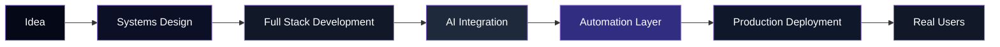

<div align="center">


<br/>


<br/><br/>

<p align="center">


</p>

<br/>

<a href="https://www.linkedin.com/in/naveen-tadaka">

</a>

<a href="mailto:naveentadaka71@gmail.com">

</a>

<a href="https://drive.google.com/file/d/14P0J3uIfKVBBDnd0KvQ-zZyNbggZP-Wi/view?usp=sharing">

</a>

<a href="https://github.com/naein19">

</a>

</div>

---

# SYSTEM PROFILE

```rust
struct NaveenTadaka {

    role: "Full Stack Engineer + GenAI Builder",

    education:
        "B.Tech CSE @ VIT-AP University",

    focus: [
        "AI Systems",
        "Automation Engineering",
        "Developer Platforms",
        "Voice AI",
        "Workflow Infrastructure",
        "Full Stack Applications"
    ],

    currently_learning: [
        "Backend Architecture",
        "System Design",
        "AI Agents",
        "Cybersecurity",
        "Scalable Infrastructure"
    ],

    operating_system:
        "Arch Linux + Hyprland",

    editor:
        "Neovim + VSCode",

    philosophy:
        "Build before perfect.
         Learn by shipping.
         Improve through iteration."
}
```

---

# ENGINEERING MINDSET

```txt
I don't build projects for tutorials.

I build systems that:
- solve real problems
- reach actual users
- automate workflows
- improve developer productivity
- combine AI with practical engineering

My focus is not just writing code.

It is designing usable systems
with real-world impact.
```

---

# ARCHITECTURE FLOW

<div align="center">



</div>

---

# FEATURED ENGINEERING PROJECTS

<table>
<tr>
<td width="50%" valign="top">

## PYQS Hub

Production-ready academic platform.

### Highlights

- Reached 500+ users within 3 days
- 60–100 daily active users
- Optimized search + filtering system
- Mobile-first responsive design
- PostgreSQL + Supabase backend

### Stack

```yaml
Frontend:
  - Next.js
  - TypeScript
  - TailwindCSS

Backend:
  - Supabase
  - PostgreSQL

Infrastructure:
  - Vercel
```

</td>

<td width="50%" valign="top">

## Friday — AI Voice Assistant

Advanced real-time AI assistant.

### Core Systems

- Real-time voice interaction
- Gemini AI integration
- Gmail automation
- Tool execution pipeline
- Weather + search APIs
- LiveKit streaming architecture

### Stack

```yaml
Backend:
  - Python
  - LiveKit
  - APIs

AI:
  - Gemini
  - Prompt Engineering
  - Tool Calling
```

</td>
</tr>

<tr>
<td width="50%" valign="top">

## FormFlow — AI Form Builder

AI-powered dynamic form generator.

### Features

- Drag-and-drop form system
- AI-generated forms
- Analytics dashboard
- Submission tracking
- Dynamic workflows

### Stack

```yaml
Frontend:
  - Next.js
  - TypeScript

AI:
  - Generative AI

Libraries:
  - dnd-kit
```

</td>

<td width="50%" valign="top">

## GenAI Multi Tool Suite

Unified AI productivity ecosystem.

### Components

- PDF Chatbot
- AI Image Generation
- AI Code Review Engine
- Multi-model workflows

### Stack

```yaml
Frontend:
  - Streamlit

Backend:
  - Python

AI:
  - HuggingFace
  - LLM APIs
```

</td>
</tr>
</table>

---

# TECH ECOSYSTEM

<div align="center">

## LANGUAGES


<br/><br/>

## FRONTEND


<br/><br/>

## BACKEND


<br/><br/>

## AI + INFRASTRUCTURE


<br/><br/>


</div>

---

# DEVELOPMENT ENVIRONMENT

<div align="center">

| System | Stack |
|---|---|
| OS | Arch Linux + Hyprland |
| Terminal | Kitty |
| Shell | Zsh |
| Editor | Neovim + VSCode |
| Workflow | Keyboard Driven |
| Design Philosophy | Minimal • Fast • Efficient |

</div>

---

# ENGINEERING ANALYTICS

<div align="center">


<br/>


<br/>


</div>

---

# CURRENT RESEARCH

```yaml
Researching:
  - AI Agents
  - Local LLM Systems
  - Backend Architectures
  - Cybersecurity
  - Automation Infrastructure
  - RAG Pipelines
  - Real-Time AI Systems

Building:
  - Voice AI
  - AI Workflow Engines
  - Full Stack AI Products
  - Automation Systems

Interested In:
  - Open Source
  - Systems Engineering
  - Developer Tooling
  - AI Infrastructure
```

---

# ENGINEERING PRINCIPLES

```txt
Most people consume technology.

I want to engineer it.

I care about:
- scalable systems
- production-ready products
- clean developer experience
- automation that removes friction
- AI with practical value
- long-term engineering impact

My edge is not specialization.

It is combining:
AI + Engineering + Automation + Systems Thinking
into usable products.
```

---

# CONNECT

<div align="center">

<a href="https://linkedin.com/in/YOUR_LINKEDIN">

</a>

<a href="mailto:naveentadaka71@gmail.com">

</a>

</div>

---

<div align="center">

# BUILD SYSTEMS. NOT EXCUSES.

<br/>


</div>
